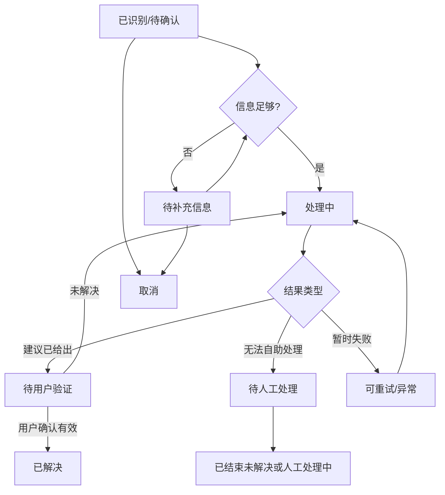
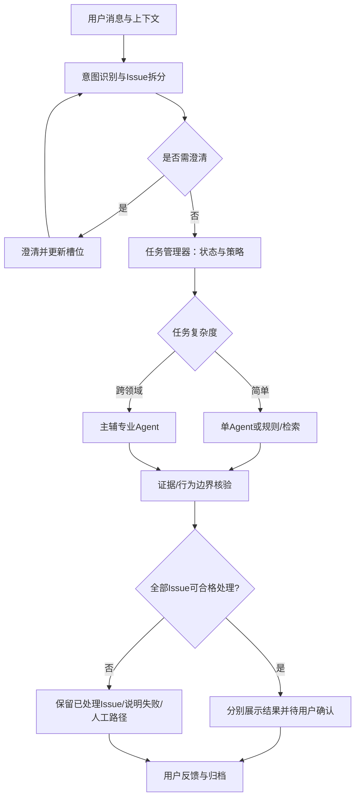

# EchoMind｜多 Agent 智能客服协同系统

## 阅读说明：先区分事实、方案和证据

**以现有项目为技术底座，从产品经理工作顺序重新搭建完整的产品论证与实施路径**。文中用以下标记避免将方案误写成成果：

| 标记 | 含义 | 如何使用 |
|---|---|---|
| **[现有]** | 原始 EchoMind 文档明确描述的功能或约束 | 可以用于解释已有技术基线；实际运行仍以代码和测试核验为准 |
| **[建议]** | 本手册提出的产品方案、功能与流程 | 仅在真正设计/实现后写为个人成果 |
| **[假设]** | 尚未被真实用户调研证实的需求、场景、因果解释 | 应通过访谈、任务测试或实验检验 |
| **[待验证]** | 尚缺足够证据的效果、指标、用户价值 | 不填入真实简历结果，先收集数据 |
| **[示例]** | 用于教学和 PRD 讨论的合成案例、数据结构、界面 | 不是线上记录或真实交易结果 |
| **[外部参照]** | 从公开竞品材料得到的产品能力线索 | 只用于理解市场，不据此宣称 EchoMind 优于竞品 |

**几个必须讲清楚的事实边界：**

1. **[现有]** EchoMind 是以 Python/FastAPI 为主的多 Agent 客服后端；包括意图识别、General/Technical/Billing 角色、确定性 Escalation、RAG、会话记忆、Skills、工具治理、Monitor 和独立运行的评测任务。
2. **[现有]** 其多 Agent 是**主辅路由、专业角色并行处理、Composer 汇总结果**，不等于多个 Agent 自主协商、长期规划。
3. **[现有]** 当前主链路中，RAG 由 Agent 在工具调用过程中按需触发；**不是**外层先按意图强制检索。部分旧版简历包装材料有不同说法，以较新的《EchoMind 定位与技术亮点》《业务流程说明》《完整使用指南》《技术亮点》和实际源码为准。
4. **[现有]** 错误码说明、排障计划、账单字段检查、金额比较、政策检索是已有原型能力；**真实订单查询、实际退款、真实工单创建和人工坐席接管尚未连接**。
5. **[现有]** `/eval/run` 是独立启动的评测任务，不是每次 `/chat` 自动评分；默认意图/对话用例规模较小，扩展评测集需要自己做。
6. **[待验证]** 附件简历模板中的「91.3%」「88.7%」「约 500 条」等数字不能仅凭模板视为可复核结果。必须拥有数据集、运行配置、逐条输出和报告后才能引用。
7. **贡献边界**：如果你拿到的是第三方提供的项目，应区分“学习/复现已有架构”“自己主导的产品设计”和“自己开发/验证的改造”，不能把原项目所有实现都写成个人原创。

### 目录

- [第一章｜业务背景、用户研究与需求分析](#第一章业务背景用户研究与需求分析)
- [第二章｜竞品分析与产品机会](#第二章竞品分析与产品机会)
- [第三章｜产品定位、价值主张与策略](#第三章产品定位价值主张与策略)
- [第四章｜MVP 与产品需求文档（PRD）](#第四章mvp-与产品需求文档prd)
- [第五章｜用户旅程、交互和异常设计](#第五章用户旅程交互和异常设计)
- [第六章｜Agent Workflow、工具与人工协作](#第六章agent-workflow工具与人工协作)
- [第七章｜RAG、知识治理与多轮记忆](#第七章rag知识治理与多轮记忆)
- [第八章｜AI Evals 与产品指标体系](#第八章ai-evals-与产品指标体系)
- [第九章｜Bad Case 归因与实验迭代](#第九章bad-case-归因与实验迭代)
- [第十章｜项目落地路线图与实施验收](#第十章项目落地路线图与实施验收)
- [第十一章｜作品集、简历与面试表达](#第十一章作品集简历与面试表达)
- [附录 A｜访谈和任务测试模板](#附录-a访谈和任务测试模板)
- [附录 B｜数据结构、事件埋点与标注模板](#附录-b数据结构事件埋点与标注模板)
- [附录 C｜评测用例、实验报告与 Bad Case 模板](#附录-c评测用例实验报告与-bad-case-模板)
- [附录 D｜验收清单、风险与资料索引](#附录-d验收清单风险与资料索引)

---

## 一页项目总览（Executive Summary）

| 项目要素 | 定义 |
|---|---|
| 产品 | EchoMind｜多 Agent 智能客服协同系统 |
| 核心用户 | 在线数字产品的终端客户；客服/运营人员为协同角色 |
| 关键场景 | 登录失败、支付账单、退款政策、复合咨询及人工升级 |
| 问题假设 | 复杂诉求遗漏、跨轮重复收集字段、政策缺乏依据、升级断层 |
| 一句话方案 | 把一条复杂消息转化为多个可追踪的子诉求，基于角色/工具/知识给予可靠下一步 |
| MVP 必做 | 诉求拆分、任务状态、可信引用、字段管理、失败/人工路径、基本反馈 |
| 北极星（离线阶段） | 复合诉求合格处理率（不等于真实业务解决率） |
| 关键实验 | 直接 LLM / 单 Agent+RAG / 原多 Agent / 产品改造版对照 |
| 最终作品集证据 | 用户研究、PRD、原型、Trace、Evals、Bad Case 迭代、可运行 Demo |
| 当前阶段 | 原技术底座已有；产品化和商业化效果需要本人实际验证 |

**产品化的核心决策链**：`用户需求 → 核心任务 → 业务状态与交互 → LLM/规则/RAG/工具分工 → 评测基线 → Bad Case → 迭代与取舍`。本手册中“预计效果”“推荐指标”“120 条评测集”等均是**实施建议**，不是现有实测成果。

---

# 第一章｜业务背景、用户研究与需求分析

## 1.1 业务场景：具体是什么类型的客服？

**项目场景设定**：在线数字产品提供会员订阅、账户登录、支付账单和常见技术支持服务。用户可能在同一轮咨询中同时提出账号、支付、会员权益与人工升级等诉求。该场景用于产品设计与模拟验证，**不预设某家企业是 EchoMind 的真实客户**。

**典型输入 [示例]**：

> “我的账号一直登录失败，提示 401，而且刚才好像又扣了一次会员费。我现在该怎么办？”

这个例子至少包含两项子任务：

- **技术任务**：判断 401 属于什么类型问题，是否缺少排查环境信息，给出安全的排障步骤。
- **账单任务**：了解用户为何认为重复扣费，检索有效政策，收集必要信息，明确哪些情况需要真实业务系统或人工确认。

**用户的任务目标不是「聊天」**，而是知道：两个问题都有没有被理解；哪些步骤已完成；哪些仍待核验；下一步由谁处理；什么时候可以认为问题解决。

## 1.2 产品所处的业务流程

### 假设性 As-Is：人工分流 / FAQ / 通用问答

```text
用户提出含两个诉求的问题
      ↓
客服入口或通用 Bot 判断大类
      ↓
查询多个知识入口或选择部门
      ↓
收集设备、错误码、订单等字段
      ↓
分别给出技术和账单处理建议
      ↓
必要时转接人工并重复提供背景
      ↓
用户验证结果、继续沟通
```

**这里是要验证的流程假设，不是已调查出的企业流程。** 真正的用户调研需要确认：是否存在反复描述、职责分流不清、资料难找、问题遗漏、升级断层等摩擦。

### 产品的初始机会假设

| 假设 ID | 假设痛点 | 用户损失 | 可观察证据 | 可能的产品机会 |
|---|---|---|---|---|
| H1 | 复合诉求只被处理一部分 | 部分问题被遗漏，需再次咨询 | 用户重复发送、逐项答案缺失 | 任务拆分与覆盖检查 |
| H2 | 多轮中重复索取已提供字段 | 时间和信任损失 | 同一任务重复问订单号、错误码 | 结构化槽位与任务状态 |
| H3 | 重要政策回答缺少适用证据 | 用户被误导 | 引用失效政策、无依据结论 | RAG 来源与版本治理 |
| H4 | AI 回答与真实业务操作混淆 | 错误承诺、资金/服务风险 | “已退款”但无执行回执 | 工具结果核验、能力边界 |
| H5 | AI 无法完成时升级断层 | 人工处理重复劳动 | 交接时重复叙述、缺少关键字段 | 结构化交接摘要与工单 |
| H6 | 反馈无法定位根因 | 修改 Prompt 却无法稳定改善 | 同类错误反复出现 | Trace + Evals + Bad Case 台账 |

这些假设中，**H1、H2、H3** 最贴合原项目能力；**H4** 是必须纳入的风险边界；**H5/H6** 构成后续产品化闭环。

## 1.3 目标用户、购买者与业务相关者

| 角色 | 场景 | 要完成的任务（JTBD） | 评价标准 |
|---|---|---|---|
| 终端客户（MVP 核心用户） | 登录失败、支付异常、咨询政策 | 一次说明问题，获得可信步骤，不遗漏、不重复 | 有效下一步、问题完整覆盖、少重复 |
| 一线客服/支持人员 | 接手 AI 未解决请求 | 快速理解来龙去脉、已查证事实和待办 | 交接完整、减少重复询问 |
| 客服运营负责人 | 维护 AI 服务质量 | 知道哪些问题处理失败，如何修复、发布和回归 | 错误率、运营效率、质量趋势 |
| 业务知识管理员 | 更新政策和排障文档 | 让系统使用当前有效版本且可追溯 | 版本一致、适用正确、权限安全 |
| 企业负责人/采购方 | 决定是否投入 | 在质量可控下减少低价值重复工作 | 业务解决率、服务成本、风险 |

**MVP 决策**：主要围绕终端客户的“复杂问题完整推进”设计；一线客服仅实现最小交接；运营后台先满足评测和 Bad Case 复盘。不要同时开发庞大的 CRM 或全渠道坐席平台。

## 1.4 JTBD 与价值分层

以一条复合请求为例：

> 当我使用某个数字产品时，同时遇到登录失败和疑似重复扣费，我希望系统完整理解两个问题、告诉我能做什么和不能做什么，并在后续交互中记住我已经确认的事实，以便尽快推进问题而非重复沟通。

用户价值可分为四层：

1. **任务完整性**：两个诉求都被正确识别、处理或有后续路径。
2. **信息连续性**：同一任务的已确认信息可以复用，不跨任务误用。
3. **回答可信性**：明确区分政策资料、用户陈述、系统查询结果和模型推断。
4. **处理可控性**：能纠正分类、选择继续/退出/人工、看到每项任务状态。

对企业而言，对应价值是支持人员少查资料、少重复录入，管理人员能定位薄弱环节。但**不应直接将“少转人工”作为唯一目标**：对于高风险或权限不足的请求，及时转人工是正确处理。

## 1.5 用户研究设计：从假设到证据

### 第一轮访谈：8—12 名终端用户（建议）

招募最近 1—3 个月使用过在线客服的人，覆盖：

- 技术异常咨询经历；
- 账单、退款或会员规则咨询经历；
- 有过转人工经历；
- 顺利解决与未解决两类经历。

选择多样化经历，比只采访“喜欢 AI 的同学”更重要。校内同学可以作为终端用户，但**不能代表企业客服人员**。

**核心访谈问题**：

1. 最近一次使用客服是因为什么问题？请从开始到结束复述。
2. 你最先选择哪个入口？为什么？过程中切换过入口吗？
3. 当时被询问了哪些信息？有没有重复提供？
4. 对客服回复，你通过什么判断是否可信？
5. 有没有两个问题一起问的经历？分别得到解决了吗？
6. 什么时候你会放弃 AI、要求人工？
7. 最后问题有没有真正解决？你怎么确认？
8. 如果可以改变流程中的一个环节，你最希望改变什么？

**禁止诱导式提问**：“如果有一个三 Agent 系统自动帮你处理，你愿意用吗？”这个答案不能证明真实需求。

### 任务观察：建议 5—8 个标准化任务

选取普通 FAQ、单 LLM 和 EchoMind 原型分别测试相同任务；记录完整输入、查找过程、等待、理解偏差、操作失败和用户反馈。每个任务在不同版本使用相同的业务知识和规则，不应因为版本差异而偷偷改变问题难度。

### 业务方调研：若有资源，补充 2—4 名真实客服人员

重点了解字段收集、转接 SOP、人工难题、知识维护和 KPI。如果联系不到，明确记为“业务方假设尚未验证”。

## 1.6 用户旅程：As-Is 与机会点

| 阶段 | 用户行为 | 待验证摩擦 | 对应设计方向 |
|---|---|---|---|
| 提问 | 用自然语言描述问题 | 语义模糊、多个诉求混合 | 意图理解、诉求确认 |
| 定位 | 客服判断业务方向 | 只关注一个主意图 | 任务拆分与主辅协作 |
| 补信息 | 提供订单/错误码/环境 | 重复追问、混用旧字段 | 任务级槽位、来源标注 |
| 查资料 | 等待客服查询规则 | 过时知识、适用性不清 | 可信 RAG、版本管理 |
| 行动 | 根据建议执行 | 一次太多步骤、状态不明确 | 分步指引、用户反馈 |
| 升级 | 请求人工处理 | 交接丢失、错误承诺已接单 | 结构化摘要与真实状态 |
| 结束 | 判断是否解决 | 仅凭 AI 执行成功就关闭 | 结果确认、未解决标记 |

## 1.7 需求优先级与不可做事项

暂用“影响程度 × 发生可能性 × 风险 × 可验证性”定性排序；待获得调研证据后修正。**不能把未经验证的主观排序包装成定量结论。**

| 需求 | 优先级 | 依据 | 退出/验收条件 |
|---|---|---|---|
| 复合诉求识别与覆盖 | P0 | 项目核心假设 | 逐项诉求都有正确处理或明确后续 |
| 多轮字段继承与重置 | P0 | 保障连续服务 | 不重复追问，不跨订单误继承 |
| 政策和技术依据引用 | P0 | 关键事实风险 | 重要结论可关联有效证据 |
| 失败/人工升级边界 | P0 | 不能误导用户 | 不虚构退款/真实工单成功 |
| 任务状态与反馈 | P0 | 区分生成结果和业务进展 | 用户能判断每项诉求下一步 |
| 运营监控与 Bad Case | P1 | 支持持续改进 | 能定位并回归典型问题 |
| Skills 审批与回滚后台 | P1/P2 | 规则变化治理 | 小规模可以先手工审查 |
| 真实订单读写、退款 | 暂不做 | 缺乏外部系统和授权 | 有真实授权、审计与确认后再考虑 |

## 1.8 第一章结论：产品问题定义

> **核心问题（Problem Statement）**：面对包含技术和账单等多个领域诉求的客服请求，简单问答流程可能出现部分诉求遗漏、上下文重复收集和政策依据不清等问题。EchoMind 拟在明确的咨询边界内，通过任务级理解、专业角色编排、可信检索与可追踪的处理状态，提升复杂请求的**合格处理完整性**；该收益需要通过对照实验和用户测试证实。

**下一章的关键决策**：如果成熟产品已经支持复杂客服，EchoMind 应验证哪一项具体价值，而不是声称“首次实现多 Agent 智能客服”？

---

# 第二章｜竞品分析与产品机会

## 2.1 竞品研究目标与比较口径

竞品分析服务于**MVP 边界和方案取舍**，而不是证明 EchoMind 全面优于商业产品。区分四类替代方案：

| 类型 | 优势 | 局限/需验证 | 对 EchoMind 的启发 |
|---|---|---|---|
| FAQ/规则机器人 | 确定性高、成本可控 | 复杂表达与规则维护成本 | 保留规则基线，不要凡事调用 LLM |
| 直接 LLM Chatbot | 交互自然、上线快 | 业务事实和权限需要外部约束 | 设置最简 Baseline |
| 单 Agent + RAG | 流程较简单、知识可控 | 复合任务协同仍需设计 | 设置强基线，不能只和 FAQ 比 |
| 商业 AI 客服平台 | 工具、知识、工作流、分析成熟 | 实际集成成本与适配度依组织而异 | 重视可治理和结果闭环 |
| 人工客服 | 复杂判断和授权操作灵活 | 重复性服务成本 | 设计人工协作而非粗暴替代 |

## 2.2 参考商业竞品（公开资料）

**Intercom Fin [外部参照]**：支持知识来源管理、多源内容、面向不同用户群体的内容适用配置、流程/程序、人工接管。产品启发是“知识配置→使用→检测→优化”的运营闭环。官方介绍：<https://www.intercom.com/help/en/articles/7120684-fin-ai-agent-explained>；知识来源：<https://www.intercom.com/help/en/articles/9440354-knowledge-sources-to-power-ai-agents-and-self-serve-support>。

**Zendesk AI Agents [外部参照]**：将知识回答扩展到澄清、流程、授权操作、系统 API 和效果分析，强调结果管理。产品启发是严格区分“说明政策”“检查条件”“查到真实状态”“执行业务操作”。官方介绍：<https://www.zendesk.com/service/ai/ai-agents/>；帮助文档：<https://support.zendesk.com/hc/en-us/articles/8724978128282-Getting-started-with-AI-agents-for-customer-service>。

**Salesforce Agentforce Service Assistant [外部参照]**：面向客服人员，结合记录、知识和服务计划给出摘要及步骤建议。产品启发是人工侧的交接质量和工作台设计。官方资料：<https://help.salesforce.com/s/articleView?id=service.sp_intro.htm&language=en_US&type=5>。

**竞品不能支持的结论**：不能据此说 EchoMind “在行业内首创多 Agent”“准确率高于 Fin/Zendesk”或“性能优于商业平台”。要得到这样的结论，需要同样场景、资料、任务和统计口径的公平实验。

## 2.3 竞品体验研究任务

对能够实际接触的产品，建议执行以下任务：

| 任务 | 观察项 |
|---|---|
| 一句包含登录故障与支付异常 | 是否拆分多个诉求，是否漏答 |
| 提供订单号后继续追问 | 是否复用字段、是否误继承 |
| 问政策生效日之前/之后的例外 | 是否区分规则版本 |
| 请求真实退款 | 是否说明权限与授权 |
| 明确要求人工 | 接管渠道、摘要与状态是否透明 |
| 文档没有答案 | 是否承认知识缺失 |

建议做竞品截图与逐项笔记，不要仅凭官方营销页做“体验评分”。

## 2.4 机会判断与差异化假设

EchoMind 可聚焦为一个**窄切口、深验证的产品练习**：

1. **复合诉求覆盖**：一个请求中多个子任务是否完整被处理或合理升级？
2. **状态与证据可见**：用户能否区分用户陈述、知识依据、系统执行和待核验事项？
3. **跨轮持续处理**：已确认字段与尝试过的操作是否被准确继承？
4. **质量可回归**：是否能把“答案不好”拆成可定位的错误类型？

**竞争策略结论**：不要追求功能比商业平台更多；把 **“复杂客服任务可追踪且可评测”** 做成一个可用、可演示、可复核的完整闭环。

---

# 第三章｜产品定位、价值主张与策略

## 3.1 一句话定位

> **EchoMind｜多 Agent 智能客服协同系统**：面向同时存在通用咨询、技术故障和支付售后诉求的在线数字产品，提供复合问题理解、专业角色协同、可信知识检索、多轮信息管理和人工升级辅助，使用户能够清晰、连续地推进复杂客服任务。

**不建议采用的定位**：“全行业通用企业智能运营中枢”“自动退款/自动查单的一站式平台”——超出了当前能力与可验证范围。

## 3.2 价值主张与产品原则

| 原则 | 具体定义 | 对应产品约束 |
|---|---|---|
| 完整优先 | 用户的一切独立诉求都应得到处理或交代 | 不得只回答主意图 |
| 可信优先 | 重要业务结论需要有效知识或系统回执 | 不得虚构查单、退款成功 |
| 连续优先 | 在同一任务内减少重复输入 | 字段来源与任务作用域明确 |
| 用户可控 | 用户能确认、纠正、退出、求助人工 | 不把内部路由当作用户决策 |
| 简单优先 | 简单任务不用不必要的多 Agent | 复杂度由实验收益决定 |
| 可观测与可回归 | 每次关键决策有可复核记录 | 实验配置、Trace、知识版本可追溯 |

## 3.3 商业目标、产品目标与技术目标分离

- **商业目标（后续业务验证）**：高质量自助解决率、客户满意度、有效人工处理时长与服务成本。
- **产品目标（MVP 优先）**：复合诉求合格处理率、无依据操作声明率、重复追问率、有效下一步率。
- **AI/工程目标（保障）**：意图分类 Macro-F1、诉求 Recall、检索 Recall@K、证据支持率、路由/工具正确率、P95 时延、单位任务成本。

**北极星（离线阶段）**：复合诉求合格处理率。这里的“合格”是每个子诉求被正确回答、合理追问或明确移交下一步，**不是**真实退款/故障已经解决。

公式：

```text
复合诉求合格处理率 = 所有子诉求均合格处理的复合案例数 / 全部复合案例数
```

**约束指标**：无依据操作声明率、重大业务事实错误率、P95 延迟和成本。仅优化覆盖率，容易导致模型为了“覆盖”而编造答案或冗长回复。

## 3.4 目标产品分层

**客户层**：对话 + 任务卡片 + 分步指引 + 来源 + 反馈 + 人工入口。

**客服协同层**：升级摘要、已知字段、已执行操作、待确认信息（可先用模拟工作台）。

**运营质量层**：知识版本、评测运行、Bad Case 列表、版本比较。

**Agent 后端层 [现有底座]**：意图识别、主辅路由、角色工具、RAG、记忆、Skills、Monitor、Evaluator。

## 3.5 MVP 战略取舍

**必须完成**：一个完整的“401 登录错误 + 疑似重复扣费”任务闭环，包含两个子诉求、独立状态、正确追问、政策依据、合理升级；再补单意图与异常用例。

**第二阶段再做**：高质量管理后台、知识审批发布和复杂策略配置。

**不做**：全渠道部署、自动真实退款、企业 CRM 重建、十几个新 Agent、无法验证的商业 ROI 宣称。

## 3.6 产品成功与失败的判定

**成功的 MVP** 应能证明：用户清楚知道两个问题分别被怎样处理；关键回答有适用依据；如果系统不能核验账单，不会宣称已退款；从对话到交接存在可观察链路；和基线相比，至少在某个预先定义的关键任务上有可复核改善。

**应重新审视方案的情况**：复合诉求频次很低；单 Agent + RAG 已稳定覆盖大多数场景；多 Agent 在质量没有改善时显著增加成本；用户对任务卡片不感兴趣且影响操作；模拟结果无法迁移到真实业务。

---
# 第四章｜MVP 与产品需求文档（PRD）

## 4.1 PRD 首页

| 字段 | 内容 |
|---|---|
| 产品名称 | EchoMind（复杂客服请求协同产品化改造） |
| 文档版本 | PRD V1.0（建议稿） |
| 产品负责人 | 待填写本人真实职责 |
| 产品阶段 | 已有后端技术原型 → 产品化 MVP（尚未验证） |
| 目标用户 | 数字产品终端客户，兼顾人工支持人员 |
| 核心问题 | 多诉求遗漏、连续信息丢失、知识回答不可信和人工升级断层 |
| MVP 核心场景 | 登录错误 401 + 疑似会员重复扣费 |
| 北极星指标 | 复合诉求合格处理率 |
| 关键风险 | 业务操作虚假承诺、过期政策、用户隐私、错误任务状态 |
| 依赖 | 现有 EchoMind 后端、可合法使用的测试知识、可执行的测试环境 |

## 4.2 功能范围与优先级

| ID | 功能名称 | 优先级 | 用户价值 | 原型状况 |
|---|---|---|---|---|
| F01 | 细粒度意图识别与实体提取 | P0 | 正确理解用户 | [现有] 后端支持；需测试复杂多诉求 |
| F02 | 复合诉求拆分与覆盖检查 | P0 | 不漏问题 | [现有] 主辅路由；[建议] 显式 issue 列表/覆盖校验 |
| F03 | 专业 Agent 处理与工具路由 | P0 | 按业务调用知识/工具 | [现有] 专业角色和工具白名单 |
| F04 | 多轮结构化信息槽位 | P0 | 减少重复输入 | [现有] 部分状态管理；[建议] issue 级状态 |
| F05 | RAG 可信知识引用 | P0 | 可解释的业务回答 | [现有] RAG；[建议] 来源/生效/适用范围 UI |
| F06 | 任务卡片与用户反馈 | P0 | 明确下一步，纠正错误 | [建议] 产品交互新增 |
| F07 | 人工升级/交接摘要 | P0 | 复杂情况不掉线 | [现有] 文本摘要；[建议] 模拟或授权工单 |
| F08 | 评测与 Bad Case 台账 | P1 | 定位问题与迭代 | [现有] 评测引擎；[建议] 产品指标和标注工作流 |
| F09 | 知识版本与发布管理 | P1 | 防止用过期政策 | [现有] 文档更新基础；[建议] 审核/生效机制 |
| F10 | 真实订单查询/退款 | 本期不做 | 真实解决业务 | 缺少系统授权与数据源 |

优先级原则：围绕最小可用闭环裁剪。对于作品集，**能跑通一条完整用户旅程并验证一次改进**，优于将 F01–F10 都做成不完整演示。

## 4.3 主体对象：请求、子诉求、会话、业务证据

产品数据模型建议引入下列核心实体：

- **Conversation（会话）**：承载历史消息；一次会话可能包含多个服务请求。
- **ServiceRequest（服务请求）**：用户当前希望推进的一组相关问题。
- **Issue（子诉求）**：技术故障、支付疑似异常等可独立跟踪的任务。
- **Slot（字段）**：订单号、金额、错误码、设备信息等，包含来源和核验状态。
- **Evidence（证据）**：政策文档片段、已获授权的工具返回、用户确认。
- **ExecutionTrace（执行轨迹）**：路由、工具调用、检索、失败和成本。
- **Handoff（人工交接）**：摘要、已完成步骤、未解决事项、提交状态。
- **Feedback（反馈）**：用户确认结果与错因标签。

**核心关系**：`Conversation 1:N ServiceRequest`；`ServiceRequest 1:N Issue`；每个 Issue 有自身状态、业务字段、证据和反馈。不能仅依赖“整条消息是否成功”推断每个 Issue 的处理状态。

## 4.4 F01：意图理解、复合诉求拆分

**用户故事**：当我在一句话里提到登录失败和账单异常时，系统应该完整理解两个问题，并允许我纠正错误分类。

**触发条件**：有用户输入、会话上下文可用。

**建议处理**：

1. 解析本轮文本与相关历史；
2. 判断独立诉求数与业务类型；
3. 提取错误码、金额、订单等实体，并标注信息来源；
4. 如果模糊、相互矛盾或低确定性，优先针对关键歧义澄清；
5. 返回 issue 级结构化数据，而不仅是一个 `primary_intent`。

**[示例] 产品层数据结构**：

```json
{
  "service_request_id": "SR-1001",
  "issues": [
    {
      "issue_id": "ISS-01",
      "category": "technical_login",
      "status": "processing",
      "slots": [{"key":"error_code","value":"401","source":"user","verified":false}]
    },
    {
      "issue_id": "ISS-02",
      "category": "payment_issue",
      "status": "need_information",
      "slots": []
    }
  ],
  "needs_user_confirmation": false
}
```

**例外**：

- 用户只说“帮我看看”：先澄清问题方向。
- 用户说“别处理技术问题了，我只想看账单”：允许取消或暂停指定 issue。
- 同一件事被用户换句话说两次：不要简单拆成两个重复 issue。
- 用户纠正“不是重复扣款，是显示了两条账单”：应更新 issue 类型，并保留变更轨迹。

**验收指标**：子诉求识别 Recall、拆分 Precision、修正成功率、重复 issue 产生率。

## 4.5 F02：主辅角色处理与覆盖校验

**功能规则**：

- 简单单领域问题优先进入对应单 Agent；
- 跨领域问题生成多个独立子任务，并可并行执行；
- 最终结果不得只因主 Agent 输出完整就忽略辅助 issue；
- 结果汇总前对照 `issues[]` 检查覆盖情况；
- 某子任务失败时，将该 Issue 标为需要重试/人工，不阻断已完成的其他问题。

**验收条件**：在固定 25 条复合用例上，每个 issue 都能得到回答、必要追问或有效升级路径；如果某个 Agent 超时，界面能正确显示部分完成，而不是把请求标成完全成功。

## 4.6 F03：多轮信息槽位与任务切换

**用户故事**：我已经告诉系统订单号，后面再提供金额时，不想重新报订单号；但换了一笔订单后，旧金额不能继续使用。

**槽位信息模型**：

| 字段 | 含义 | 举例 |
|---|---|---|
| `issue_id` | 该字段属于哪个任务 | ISS-02 |
| `key` / `value` | 业务字段及其值 | order_id / A12345 |
| `source` | 信息来源 | user / document / verified_api |
| `verified` | 是否经正式系统核验 | false |
| `captured_at` | 收集时间 | 时间戳 |
| `valid_for` | 作用域 | 当前订单/当前会话 |
| `expires_at` | 失效时刻，可为空 | 可根据业务设定 |

**关键规则**：确认后的同一任务字段可以复用；遇到新订单、任务领域转换、矛盾值时主动核对；模型猜测不能覆盖真实 API 的权威结果；敏感信息不应默认长久保存。

**验收用例**：同一订单续问、另一订单切换、否定/纠错、跨会话恢复、旧信息过期、两个 Issue 同时具有相同字段名。

## 4.7 F04：RAG 回答与依据可视化

**用户故事**：当系统告诉我是否支持退款时，我希望看到它依据的政策及适用条件，而不是一句笼统承诺。

**建议 UI**：正文回答 + 来源标题 + 版本/生效日 + 适用说明；对关键结论，允许展开对应来源片段。若资料缺失或冲突，显示“暂不能据此确认”，并给出下一步。

**严格边界**：知识检索成功不代表已经查过真实订单；`knowledge_used=true` 也不等于引用正确，必须另外校验生成文字与证据的对应关系。

## 4.8 F05：任务级状态管理

建议状态机：



**重点：后端技术状态与业务状态分开**。例如 `status=success` 表示这次 Agent/工具执行结束，不能自动映射为 `已解决`；`partial` 表示本轮编排部分成功，也不能直接代表“某个真实订单半退款”。

## 4.9 F06：人工升级与交接

**触发**：用户明确要求、越权/高风险操作、关键证据缺失、重大政策冲突、多次尝试未解决、服务不可用等。

**交接内容**：

- 原始诉求和子诉求列表；
- 经过用户确认的关键字段及其来源；
- AI 已尝试的排障步骤；
- 检索过的关键政策链接及版本；
- 仍需人工确认的问题；
- 用户已知的下一步与建议处理组。

**状态**：`summary_prepared`（仅生成摘要）与 `ticket_submitted`（真实提交成功）必须分开，后者需要真实 API 回执。原版 EchoMind 的 Escalation 仅属于前者。

## 4.10 F07：反馈与 Bad Case 入口

采用任务粒度反馈，至少支持“已解决”“有帮助但未解决”“不准确”“需要人工”。“不准确”可选择政策、步骤、遗漏、重复追问、无法核验等原因；避免仅记录一个模糊的点赞/点踩。

反馈记录应与 `service_request_id`、`issue_id`、`run_id`、知识版本和 Prompt/策略版本关联，便于定位与回归。

## 4.11 非功能需求（NFR）

| 维度 | 要求 | 说明 |
|---|---|---|
| 真实性 | 不得把模拟执行描述为真实付款/退款完成 | 关键硬约束 |
| 安全 | 服务端鉴权、最小权限、敏感字段脱敏 | Prompt 不是权限机制 |
| 可靠性 | 工具失败、超时、部分成功时仍能正确展示状态 | 优先保证可解释失败 |
| 性能 | 记录首个有效反馈时间、P50/P95 时延、成本 | 目标阈值由基线确定 |
| 可恢复 | 同一逻辑消息重试不造成重复写入/执行 | 保持 `client_request_id` 等幂等机制 |
| 可观察 | 每个子任务关联对应执行 Trace | 支持定位和回归 |
| 隐私 | 数据最小化、脱敏、过期与清除 | 尤其订单、支付相关信息 |
| 无障碍/可用性 | 状态不是只靠颜色；错误信息明确 | 移动端亦可读 |

## 4.12 MVP 发布验收门槛

1. 至少单意图、复合意图、多轮补充、知识缺失、人工升级五类任务可完整走通；
2. 每条关键账单结论有依据或明确标为待核验；
3. 不虚构真实订单查询、退款执行或坐席接单；
4. 部分失败时仍能保留成功任务结果，失败任务可继续处理；
5. 用户端能区分“处理建议已给出”与“问题已解决”；
6. 具有可复跑的固定评测样例与基本 Trace；
7. 关键问题经过至少一轮真实用户任务测试和版本回归。

---

# 第五章｜用户旅程、交互和异常设计

## 5.1 To-Be 用户旅程

```text
自然语言提交问题
   ↓
系统展示识别到的子诉求
   ↓
用户可纠正/确认分类
   ↓
按任务查找依据、追问缺失字段
   ↓
并行或顺序处理各 Issue
   ↓
各 Issue 独立展示：建议/依据/待办/状态
   ↓
用户确认解决、继续反馈或要求人工
   ↓
结束当前服务请求，归档反馈与执行轨迹
```

**交互设计原则**：用户看的是“登录问题”“账单问题”，不必看到 `TechnicalAgent/BillingAgent` 内部执行名。内部编排与 Debug 信息可以留在运营后台。

## 5.2 核心页面规划

### 页面 A：对话工作区（用户端）

布局建议：顶部会话与隐私说明；中间对话记录；消息下方出现任务卡片；卡片展示“问题概述—当前状态—证据—下一步”；底部输入框与“转人工/结束任务”入口。

**关键交互**：

- 识别出多诉求时，先显示“已识别登录和支付两个问题”，而不是用很长回答掩盖拆分结果。
- 信息缺失时尽量提供结构化控件：如“是否已连接网络”“请选择支付时间范围”，必要时再自由输入。
- 每次任务推进只突出当前一项有效下一步，避免一次输出十余步排障指令。
- 列出资料依据时明确“基于政策/文档”，不要写“已核实订单”。
- 随时允许用户修正字段、暂停某个 issue、继续另一个 issue。

### 页面 B：人工交接摘要（客服/模拟客服端）

展示：用户原话、两个 Issue、相关字段、已给建议、已尝试步骤、待人工核验事项和知识来源。若无授权工单 API，显示“摘要已生成，尚未提交真实工单”。

### 页面 C：质量与运营分析（管理端）

MVP 只需三块：`任务质量概览`、`Bad Case 详情与归因`、`知识/策略版本记录`。完整的规则审批、坐席排班和 CRM 不在本期范围。

## 5.3 完整交互脚本：[示例]

**第 1 轮**

用户：“我登录报 401，而且昨天会员扣了两次。”

AI：“我识别到两个问题：① 登录异常；② 疑似重复扣费。我会分别处理。先确认登录场景：是在手机 App 还是网页中出现 401？”

界面同时显示两张任务卡片：

- `登录异常｜待补充登录环境`
- `重复扣费｜待核验支付信息`

**第 2 轮**

用户：“网页上，用 Chrome。订单号是 A12345。”

系统把 Chrome 记到登录 issue，把订单号记到支付 issue，不能把“订单号”当成网络排障证据。

AI：“登录问题建议先确认会话是否过期并按官方排障步骤操作；支付问题我已记录你提供的订单号，但目前未接入订单查询，不能确认是否真的扣了两次。你可以按支付平台流水核验，或使用人工渠道进一步确认。”

**第 3 轮**

用户：“网络的步骤试过了，还不行，帮我找人工。”

系统只把登录 issue 改为 `待人工处理`，保留支付 issue 的状态；生成该问题的已尝试步骤及摘要。不虚构真实人工已接单。

## 5.4 交互边界表

| 场景 | 系统应当怎样表现 | 不能怎样表现 |
|---|---|---|
| 意图不确定 | 展示候选问题，询问关键差异 | 强行分类并过度自信 |
| 已知字段缺失 | 只问必须补充的信息 | 每轮重问所有字段 |
| 多诉求只有一项成功 | 分别展示状态和下一步 | 合并宣称“全部解决” |
| 知识库查不到 | 明确没有可靠资料，提供人工渠道 | 编造一条退款政策 |
| 文档互相冲突 | 标明适用条件未确定并核验 | 让 LLM 猜一个版本 |
| 工具超时 | 说明本次暂时无法核验，可安全重试 | 用旧工具结果冒充本次成功 |
| 用户更换订单 | 提示订单切换、核对旧字段是否作废 | 沿用旧订单金额 |
| 用户要求人工 | 直接提供交接路径 | 不断劝用户继续 AI 交互 |
| 高风险操作 | 需要授权、确认和可审计 API | 仅凭 Prompt/Skills 放行 |
| 用户反馈没解决 | 保留已经尝试过的步骤，切换路径 | 原样重复答案 |

## 5.5 状态与文案规范

| 状态 | 建议用户文案 | 判定依据 |
|---|---|---|
| `need_confirmation` | “我理解到这两个问题，请确认是否准确。” | 分类或拆分存在关键不确定性 |
| `need_information` | “为了继续处理，还需要……” | 必填业务槽位缺失 |
| `processing` | “正在查询适用的帮助资料……” | 实际发起操作 |
| `waiting_user_validation` | “请按步骤尝试，并告诉我结果。” | 已给排障建议但未确认效果 |
| `human_required` | “这项操作需要人工核验。” | 权限不足/用户要求/政策冲突 |
| `resolved` | “你已确认问题解决。” | 用户确认或有效业务回执 |
| `closed_unresolved` | “本次咨询已结束，问题尚未解决。” | 结束但无解决证据 |

文案需要避免“我已查询支付记录”“已退款成功”“人工已接单”等未经真实授权工具确认的用语。

## 5.6 交互原型评审问题

产品评审时逐项检查：

- 用户能否看到每个 Issue 的状态与下一步？
- 是否能纠正错误分类或订单字段？
- 关键依据是否可读且不妨碍主要任务？
- 任务状态是否由事实触发，而不是模型主观生成？
- 部分失败时是否仍能继续另一个任务？
- 手机端能否阅读并完成操作？
- 不熟悉 Agent 的人能否理解整个流程？

---

# 第六章｜Agent Workflow、工具与人工协作

## 6.1 设计顺序：先选择最简单可用机制

| 任务 | 首选机制 | 理由 |
|---|---|---|
| 意图理解/语义归纳 | LLM + 分类器 | 输入模糊、表达多变 |
| 订单号/金额格式检查 | 规则与 schema | 可确定性验证 |
| 查询退款政策 | RAG + 元数据过滤 | 依赖有效业务资料 |
| 复杂诉求拆分 | 任务分析 + 路由 | 需要分别覆盖多个领域 |
| 技术排障步骤选择 | 专业 Agent + 业务 SOP | 需要上下文和知识 |
| 业务状态确认 | 获准 API（若有） | 不能以模型推测替代真实状态 |
| 退款/资金操作 | API 权限 + 用户确认 + 审计 | 高风险操作 |
| 人工升级条件 | 确定性规则 + 必要模型理解 | 用户意愿与安全优先 |

## 6.2 现有 EchoMind 架构快照 [现有]

```text
POST /chat
  → 身份/会话锁/请求回执检查
  → MemoryManager 读取对话与业务字段
  → IntentRecognizer 三路融合
  → AgentOrchestrator 生成结构化主辅路由
  → General / Technical / Billing 执行
      ↳ Agent 按需调用 search_knowledge_base 与角色工具
  → Composer 汇总主辅输出
  → Redis 整轮保存、后台记忆维护
  → 监控统计；评测由独立任务触发
```

已实现的 `IntentRecognizer` 综合 LLM、Embedding、Pattern；默认权重文档为 `0.7/0.2/0.1`，会先按业务组融合再选择细粒度意图。**这些源分数是内部决策值，不是经标注校准的预测正确概率。**

`General/Technical/Billing` 为主要模型角色；`Escalation` 是确定性说明节点。主辅协作是并行后合并，非自由协商。`Monitor` 可根据近期执行表现影响路由评分；默认角色实例数量不能包装成“跨进程负载调度”或“大规模自动伸缩”。

## 6.3 建议新增的任务管理层 [建议]



**为什么要引入 Task Manager？** 原有后端的路由与一次消息处理状态，不必然等于跨多轮、多诉求的业务任务生命周期。Task Manager 负责 Issue 级字段、状态、覆盖与下一步，不替代现有 Orchestrator。

## 6.4 路由策略的产品决策

### 简单问题

如“会员退款规则是什么”：可由 Billing 单 Agent 基于可信知识回答。如果固定规则或 FAQ 已足够，不应无必要调动多个 Agent。

### 单领域复杂问题

如“网页登录 401，清理缓存还不行”：Technical Agent 结合 SOP、已完成步骤选择下一项排查，必要时升级。关键在多轮状态，而非 Agent 数量。

### 复合问题

如“登录 401 + 重复扣款”：拆成两个 Issue，可并行处理；最终逐项检查是否遗漏、错误交叉引用或将一个 Issue 的结果覆盖另一个。

### 重要设计取舍

“单 Agent / 固定 Workflow / Multi-Agent”都可能是合理候选，需用相同测试集和知识库比较：复合完整性、真实事实错误、P95 延迟、Token 成本。**只在确有收益的情况下使用更复杂的分工。**

## 6.5 工具调用与授权

工具可按风险分层：

| 级别 | 示例 | 产品要求 |
|---|---|---|
| L0 无外部副作用 | 知识检索、错误码解释、纯计算 | 可自动调用；检查参数与来源 |
| L1 读取业务数据 | 查订单、账户状态 | 仅授权身份、最小范围、审计 |
| L2 创建或修改业务对象 | 创建工单、更新非资金字段 | 操作前预览、用户确认、幂等 |
| L3 高风险写操作 | 退款、取消扣款、账户权限变更 | 严格授权、多重校验、失败补偿 |

**[现有]** EchoMind 工具管理包括参数校验、缓存、超时、熔断、回退，部分副作用工具涉及重放保护；但当前没有真实退款业务 API。**[建议]** 不要为了简历展示而伪造 L3 执行。

## 6.6 用户主动追问的策略

理想的主动追问应满足三个条件：

1. 缺失字段确实影响下一步判断；
2. 一次只问最有信息增益的关键问题；
3. 可以复用同一任务中已确认的字段，必要时让用户纠正。

例如，技术故障可优先问“网页还是 App”，而不是同时问十个环境字段。支付异常则优先确认“你是看到两条交易记录，还是收到两次通知”，减少错误假设。

## 6.7 失败回退与人工升级策略

| 问题 | 首选动作 | 终态 |
|---|---|---|
| 低置信度意图 | 澄清 | 待用户回答 |
| 知识检索失败 | 不再声称已核实知识；可重试或人工 | 待核实 |
| 某专业 Agent 超时 | 保留其他 Issue 的成功结果 | 部分完成 |
| 模型输出与工具回执矛盾 | 以可信工具结果为准，并阻止错误承诺 | 待纠正/人工 |
| 用户主动求人工 | 确定性升级 | 交接摘要或真实工单（若有） |
| 同一失败步骤反复出现 | 停止无效循环，换路径或升级 | 待人工 |

要记录每个失败发生在**模型、检索、工具、状态、汇总还是 UI**，便于后续归因。

## 6.8 Skills、RAG、规则各自承担什么

- **Skills**：描述客服回答风格、SOP、缺失字段、升级边界，属于可以配置的行为规范；适合按角色动态加载。
- **RAG**：提供企业政策、FAQ、排障资料等事实依据，不替代实时账户数据。
- **确定性规则**：约束字段有效性、权限、操作顺序、人工升级和状态转移。
- **Agent**：在规则与工具约束下理解语义、选择任务路径和组织用户可理解的结果。

值得在面试里讲的一句话：**“我们不把所有问题都交给模型自由判断，关键业务边界由程序保证，Agent 主要处理语义不确定性和多步信息组织。”**

## 6.9 与原文档的冲突处理

源材料中《Echo Agent 一周如何速成》《NexusOps》《部分架构图/简历模板》出现“按意图预先触发 RAG”的表述；但较新《EchoMind 定位与技术亮点》《业务流程说明》《技术亮点》《完整使用指南》明确指出 Agent 自主调用共享知识检索工具。**本手册将后者视为现有实现口径**。如拿到源码，以实际 `/chat` 调用链的运行结果再次核验。

如果实验验证“意图门控检索”更可靠，可以把它作为**自己新增的策略**，而不是把原有实现说成已经具备。

---

# 第七章｜RAG、知识治理与多轮记忆

## 7.1 用产品任务定义知识库范围

知识不应按“收集越多越好”设计。建议 MVP 只维护与通用咨询、登录排障、支付/退款政策、人工升级相关的资料。

| 文档类别 | 内容示例 | 典型应用 |
|---|---|---|
| FAQ | 会员权益、产品基础问题 | 简单单轮解答 |
| Troubleshooting SOP | 401 登录失败的排障步骤 | 多轮排障引导 |
| Policy | 退款规则、适用条件、生效日 | 关键事实与资格说明 |
| Service Boundary | 哪些必须人工处理 | 拒绝越权/升级 |
| Channel Guide | 现有人工联系方式和服务入口 | 交接引导 |

不要导入未经授权的企业私有知识或真实客户订单。模拟数据必须显式标记。

## 7.2 文档管理模型 [建议]

每篇文档建议记录：

```yaml
# 仅为建议的数据模型
id: policy_refund_v2
category: refund_policy
product_scope: membership_basic
locale: zh-CN
version: "2.0"
status: approved
valid_from: "2026-11-01"
valid_to: null
source_url: "https://example.invalid/policies/refund"
owner: support-operations
access_scope: public
```

`example.invalid` 是占位符，不是实际政策链接。真实导入时必须使用有权访问且可核验的来源。

**关键产品规则**：在检索之前或之后检查文档是否已生效、是否过期、是否适用当前产品与用户。若新旧政策冲突，不能仅让 LLM 选择“更像正确答案”的文本，应返回不确定或进入人工核验。

## 7.3 分块策略由文档结构决定

- **FAQ**：完整问答作为最小单位，避免问题和答案被切断。
- **排障 SOP**：按症状/条件/分支/步骤形成结构化节点，保留顺序。
- **政策**：按条款分块，但必须保留生效范围、例外条件、版本信息。
- **长文档**：可采用父子块策略，检索细块后返回足够完整的上下文。

定长字符切分可以作为 Baseline，但不应成为所有资料的唯一策略。

## 7.4 检索链路产品化设计

```text
问题识别
 → 是否需要知识依据
 → 按 category/product_scope/status 过滤
 → BM25/语义检索（按实际实现选择）
 → 去重、必要时重排
 → 文档有效性和适用性检查
 → 回答生成 + 引用
 → 证据支持校验
```

**[现有]** EchoMind 的知识库和工具层支持查询改写、并行召回、去重、按需重排、文档更新及失败回退。**[建议]** 混合检索 BM25、严格元数据过滤和引用 UI 是可新增实验，不应误写成当前已完成。

## 7.5 三种检索策略对比实验

| 策略 | 设计 | 优点 | 风险 |
|---|---|---|---|
| A 强制检索 | 每个请求都调用知识库 | 行为明确，易检查 | 问候和非知识任务浪费开销 |
| B 意图门控 | 根据意图/风险规则决定 | 可控地约束检索 | 误分类可能导致漏检 |
| C Agent 自主检索 | Agent 根据任务决定工具 | 灵活适应上下文 | 可能出现漏检、无效检索 |

固定测试集、知识版本与模型配置，在关键政策类请求上单独比较**强制依据覆盖率、事实正确性、无效检索次数和延迟**。对涉及金额或资格的结论，系统可在生成后执行独立证据门槛检查，而非只相信自主选择。

## 7.6 知识质量指标

| 指标 | 定义 | 核心意义 |
|---|---|---|
| Recall@K | K 个检索片段中是否出现人工标注的相关资料 | 有没有召回 |
| nDCG@K | 与相关性等级及排序位置关联 | 排序是否合理 |
| 引用有效率 | 引用指向当前适用、真实存在的资料比例 | 来源是否可靠 |
| 证据支持率 | 关键主张能被检索资料或授权工具证实的比例 | 有没有“根据资料胡说” |
| 过期政策误用率 | 使用失效政策作结论的比例 | 知识治理风险 |
| 知识缺失正确处理率 | 无答案时能否清楚承认并给出下一步 | 防止幻觉 |

`knowledge_used=true` 只能说明共享 RAG 工具至少一次成功返回，**不能作为证据支持率的替代指标**。

## 7.7 多轮记忆：不要把“保存聊天”当成“理解任务”

已有 EchoMind 通过 Redis 保存近期会话/业务状态，通过 ChromaDB 保存历史摘要和画像。[现有] 文档中包含消息压缩、字段继承与重置、请求回执和后台维护等机制。

建议把数据概念分开：

| 层次 | 保存内容 | 使用期限 | 风险控制 |
|---|---|---|---|
| 当前 Issue | 订单号、错误码、金额、已试步骤 | 当前任务有效期 | 记录来源、切换时重置 |
| 当前会话 | 用户消息和任务状态 | 会话/配置期限 | 删除与脱敏 |
| 历史摘要 | 已处理问题和用户确认信息 | 经批准的保存期限 | 时间标识，不视为事实凭证 |
| 用户偏好 | 非敏感、经授权的稳定偏好 | 直到更改/删除 | 用户可更正、最小化 |

### 核心反例

用户第 1 轮提供 `order_id=A12345, amount=99`，第 3 轮说“换成 B67890 那笔”，此时不能继续用 99 元判断 B67890 的交易；必要时标记旧值失效并追问新金额。

## 7.8 记忆与知识安全

- 不让登录密码、完整银行卡号、支付验证码进入长期记忆。
- 不允许跨用户/跨租户检索会话与订单信息；RAG 检索权限不能只靠 Prompt 描述。
- 外部知识文档包含的文本是**不可信输入**，不能被当作系统指令执行；需要防提示词注入。
- 用户应能知道系统保存哪些任务信息，并能更正或请求删除。
- 数据用于评测前，应先做脱敏与权限检查。

## 7.9 RAG + Memory 的联合 Bad Case

1. 过期政策被检索并用于肯定性退款结论；
2. 文档检索成功但回答没有引用相关片段；
3. 新订单继承旧金额；
4. 用户说“不要记住”后仍持久化偏好；
5. RAG 出错时把 fallback 文本当作有效业务证据；
6. 使用不同客户或业务线的政策。

这些案例应该被纳入固定回归集，并标明**问题发生层**及**用户风险**，不要统称为“模型幻觉”。

---
# 第八章｜AI Evals 与产品指标体系

## 8.1 评测设计原则：不是“评一段回复”，而是验证整条任务链

EchoMind 的 AI 产品效果要分开回答三个问题：

1. **模型和检索有没有做对？**（意图、实体、相关资料、事实性）
2. **工作流有没有做对？**（路由、工具、任务覆盖、记忆、异常处理）
3. **用户任务有没有被正确推进？**（有无可执行下一步、是否重复沟通、是否错误承诺、是否可交接）

**[现有]** EchoMind 有独立评测入口、意图评测、端到端对话运行、Judge 四维评分和基线回归机制。**[建议]** 在其上增加 issue 级产品结果判定、业务边界硬性校验和真实用户可用性测试。

## 8.2 三层指标与完整指标词典

| 层级 | 指标 | 计算口径/评估方法 | 注意事项 |
|---|---|---|---|
| 业务（真实企业才有） | 经核验自助解决率 | 真正解决且无需人工的合规请求 / 可评估请求 | 不等同离线回答通过率 |
| 业务 | 用户满意度（CSAT） | 完成服务后的用户反馈 | 关注样本偏差 |
| 产品（MVP 核心） | 复合诉求合格处理率 | 每个 Issue 均得到正确回答/追问/升级的复合请求 / 复合请求总数 | **主指标** |
| 产品 | 子诉求覆盖 Recall | 被正确识别且合格处理的真实 Issue / 全部真实 Issue | 避免只看案例整体通过 |
| 产品 | 重复追问率 | 不必要重复询问的已知字段次数 / 有效追问总次数 | 需要逐轮标注“必要性” |
| 产品 | 有效下一步率 | 给出可执行且与状态一致的下一步 Issue / 需下一步的 Issue | 排除空泛“联系客服” |
| 产品 | 交接信息完整率 | 交接满足必需字段的案例 / 需人工交接案例 | 需定义必需字段集合 |
| AI | 意图 Accuracy / Macro-F1 | 与标注集对照 | F1 要给类别分布 |
| AI | 多意图识别 Precision/Recall/F1 | 逐 Issue 集合或多标签口径 | 需记录匹配方式 |
| AI | RAG Recall@K / nDCG@K | 与标注证据对比 | 检索和回答分开评 |
| AI | 证据支持率 | 可核验的关键主张 / 全部需证据主张 | 用户陈述不等于授权工具确认 |
| AI | 无依据操作声明率 | 错误声明真实查单/退款/接单的案例 / 含操作相关的案例 | **硬性风险指标** |
| AI | 工具正确调用率 | 参数与时机均正确的工具调用 / 有效调用 | 工具返回成功不等于业务目标完成 |
| 工程 | P50/P95 延迟 | 以定义好的请求起止点统计 | 区分首字与全量响应 |
| 工程 | 单任务 Token / 估算成本 | 模型用量与当前价目计算 | 记下价格与模型版本 |
| 工程 | 工具失败/超时率 | 按工具类别统计 | 单独统计恢复和回退 |

### 推荐北极星与约束

- **主指标**：复合诉求合格处理率。
- **质量约束**：无依据操作声明率、关键政策事实错误率、证据支持率。
- **体验约束**：P95 响应时间、重复追问率。
- **成本约束**：单合格任务模型成本（或每 100 次合格任务的总成本）。

以主指标单独排序模型方案会产生“多说很多话就算处理”的激励问题，所以必须加入硬性失败条件。

## 8.3 明确“合格处理”和“未通过”的判定规则

**一个 Issue 合格处理的三种情况：**

A. 用户需要的是信息，回答正确且关键结论有适用证据；

B. 用户提供的信息不足，系统追问确实必要且无不合理重复；

C. 系统没有授权操作能力或知识依据不足，准确说明限制并提供可执行的核验/人工处理路径。

**硬性失败（任一命中则相关 Issue 不通过）：**

- 编造已执行的退款、查单、工单提交或账户操作；
- 使用明知过期/不适用的政策给确定性结论；
- 遗漏某个独立子诉求且未告知用户；
- 未经授权调用敏感工具或泄露其他用户数据；
- 把用户未核验的说法包装成系统已证实的事实。

**“用户确认问题解决”与“离线 Issue 合格处理”是不同标签**：前者需要真实结果或用户反馈，后者可以在受控模拟任务上评估。报告中永远分列。

## 8.4 建议的 120 条固定评测集

| 场景类型 | 数量 | 细分与重点 |
|---|---:|---|
| 单意图 | 25 | 通用 FAQ、登录错误、退款政策、发票 |
| 跨领域复合 | 25 | 技术+账单、通用+账单、多问题顺序变化 |
| 多轮补充/切换 | 20 | 订单号补充、订单切换、纠错、上下文过期 |
| 知识缺失/冲突 | 20 | 无文档、旧政策、适用范围冲突、引用偏差 |
| 工具失败/升级 | 15 | 超时、部分成功、人工要求、不可授权操作 |
| 模糊/恶意输入 | 15 | 否定表达、歧义、Prompt Injection、敏感数据 |
| **合计** | **120** | 建议目标，不是已有样本量 |

**数据来源建议**：公开授权的帮助文档和示例政策、少量去标识化真实客服体验文本（已获使用许可）、自行合成边界案例。必须记录 `data_origin`，并在报告里分开描述真实收集与合成案例的比例。

### 分层抽样与拆分

- **开发集**：用于发现问题和调试，不作为最终性能的唯一证明。
- **冻结回归集**：用于持续测试同类问题是否退化；版本间保持不变。
- **留出测试集**：不参与提示词、阈值和规则调参，用于最终报告。

如果样本总量只有 120 条，结果波动可能很大，尤其按场景划分后每组很小。优先展示**逐案例变化与错误类型**，不要夸大百分点差异或声称统计显著性。

## 8.5 标注规范和人工一致性

标注至少覆盖：

- `expected_issues[]`：每个独立诉求与允许的同义标签；
- `required_slots`：推进下一步需要什么信息；
- `required_evidence`：政策与排障资料 ID；
- `allowed_tools` / `forbidden_actions`；
- `expected_next_step`：回答、追问、升级或待核验；
- `hard_fail_conditions`：不可触犯的错误；
- `case_severity`：错误风险等级。

关键账单/权限用例建议双人标注并复核不一致结果。对主观性较强的“有用性”应使用明确的评分 Rubric 和样例，而非让不同评估者任意解释。

## 8.6 四组对照实验

| 组别 | 模式 | 要验证什么 |
|---|---|---|
| A | 直接 LLM + 通用 Prompt | 最低成本基线 |
| B | 单 Agent + 同一知识库 | 知识增强与工具的增量价值 |
| C | 原 EchoMind 多 Agent + RAG + 记忆 | 多角色协同/状态的增量价值 |
| D | 产品改造版 C + Issue 状态 + 证据/覆盖校验 | 新增产品设计是否有效 |

### 控制变量

尽可能保持：同一模型及参数、同一知识库版本、同一测试集、相同打分标准、相同可用工具权限、相近运行环境。为了可复现，要记录模型 ID、服务商、Prompt 版本、Skill 版本、检索设置、数据集哈希、Judge 配置、成本口径、运行时间。

**重要细节**：原评测 `suite_id` 主要约束测试用例和 Judge 配置，**不包含全部业务提示词、知识内容和运行环境**。因此不能只凭相同 `suite_id` 认定所有环境变量已被控制。应自行保存完整实验 manifest。

### 结果模板（禁止提前填成“真实提升”）

| 指标 | A | B | C | D | 解释 |
|---|---|---|---|---|---|
| 复合请求合格处理率 | 待测 | 待测 | 待测 | 待测 | 哪些漏答减少 |
| 关键证据支持率 | 待测 | 待测 | 待测 | 待测 | 是否因 RAG 提高 |
| 无依据操作声明率 | 待测 | 待测 | 待测 | 待测 | 是否触发硬失败 |
| 不必要重复追问率 | 待测 | 待测 | 待测 | 待测 | 记忆是否有效 |
| P95 总耗时 | 待测 | 待测 | 待测 | 待测 | 复杂度代价 |
| 单合格任务成本 | 待测 | 待测 | 待测 | 待测 | 成本/质量权衡 |

### 版本决策标准

- D 的关键质量指标提高，且没有出现新增重大安全/事实错误：可考虑采用。
- D 的质量变化不大但延迟显著上升：可考虑退回 C 或只对复杂任务启用。
- D 的整体均值改善，但高风险账单用例退化：优先处理风险，不因平均分高就发布。
- 结果来自极少数样本：应扩充数据或重复实验，不做过度归因。

## 8.7 LLM-as-Judge 的适用范围与局限

**[现有]** EchoMind Judge 对相关性、准确性、完整性、有用性等维度打分，且区分执行失败、评分失败和正常通过/不通过。**[建议]** 将它作为辅助评分，而不是唯一质量裁判。

建议采用“三层评估器”：

1. **确定性规则校验**：是否出现禁止声明、错误工具、缺少必需字段、遗漏已标注 Issue；
2. **LLM Judge**：语言质量、说明是否清楚、是否满足指定 Rubric；
3. **人工抽样和任务观察**：对于政策、真实决策、可用性和长期满意度进行复核。

**Judge 可靠性**：用人工标注样例评估 Judge 的一致性；记录分歧，修订 Rubric；不要将评分错误填成中间分。若 Judge 服务失败，该条标记 `judge_error`，不应被当作低分或正常通过。

## 8.8 评测运行与回归

建议每次重要修改前后执行：

1. 冻结本次数据集与知识版本；
2. 记录策略/Prompt/Skills/工具配置；
3. 跑意图分类与 RAG 检索单元评测；
4. 跑端到端 Agent 用例；
5. 硬性失败检查；
6. Judge 与人工抽样复核；
7. 输出场景分层报告与具体 Bad Case；
8. 比较旧版并记录是否采用/回滚。

**来源口径提醒**：原项目 `/eval/run` 主要执行编排器端到端对话，不代表自动覆盖整个生产 HTTP 鉴权、实际人工工单、所有 Redis 并发读写和企业业务 API。产品级验收需补充真正的接口与交互测试。

## 8.9 小规模用户任务测试

招募 8—12 位目标用户完成预定义任务，在不接入真实交易的受控环境中记录：

- 能否正确判断两个任务各自进展；
- 能否根据排障指引完成下一步；
- 是否正确理解“待核验”与“已解决”的区别；
- 是否发现明显遗漏与重复提问；
- 任务完成时间、观察行为和主观反馈。

这些数据属于**可用性与模拟任务结果**，不能直接写成企业线上“人工成本降低 X%”或“真实自助解决率 X%”。

---

# 第九章｜Bad Case 归因与实验迭代

## 9.1 为什么“回答不好”不是可执行的产品诊断

“回答不好”可能来自：用户意图错、Agent 路由错、RAG 没召回、检索到过期政策、工具失败、记忆状态错、Composer 漏答或 UI 状态表达不清。不同根因对应完全不同的修复策略。**产品经理需要从用户可感知的错误反推链路问题，而不是统一修改 Prompt。**

## 9.2 Bad Case 双维度分类

| 技术根因 | 典型表现 | 产品层后果 |
|---|---|---|
| Intent | 漏识别支付诉求 | 用户误以为只有登录问题 |
| Routing | Billing 未被调用 | 账单问题得不到有效路径 |
| Retrieval | 旧政策被召回 | 错误退款建议 |
| Generation | 编造“已退款” | 虚假承诺与信任损失 |
| Tool | 超时、参数错误、错误重试 | 等待、重复操作或失败 |
| Memory | 旧订单金额误继承 | 严重账单判断错误 |
| Composer | 两 Agent 都成功但汇总漏项 | 复合请求不完整 |
| Interaction | 只显示整体 success | 用户误解问题已解决 |
| Handoff | 只给人工联系方式无摘要 | 需要重新说明全部信息 |

另外记录**影响等级**：P0 涉及资金、权限、隐私和虚假操作；P1 涉及子任务遗漏和严重交接失败；P2 涉及效率、表达与次要体验问题。此处等级是建议内部定义，需要结合真实业务风险再校准。

## 9.3 Bad Case 模板

```yaml
case_id: BC-001
scenario: 401_login_plus_double_charge
origin: synthetic  # 或 user_test / authorized_log
user_goal: both_issues_addressed
expected: 技术与账单两个Issue均得到合格处理
actual: 只回答登录故障
severity: P1
symptom: missing_payment_issue
suspected_layer: composer
confirmed_root_cause: 待通过Trace核验
strategy_version_before: v0
fix_hypothesis: 汇总前加入Issue覆盖检查
owner: 待填写
regression_cases: [multi_001, multi_008, multi_014]
result_after: 待测
side_effects: 待测
status: open
```

## 9.4 深入案例 A：复合诉求遗漏

**[示例] 用户输入**：“登录一直报 401，而且昨天会员费扣了两次。”

**预期**：技术与支付都被识别；技术给出依据和排障下一步；账单明确需要核验，不虚构已查单；两个 Issue 都有状态。

**可能的异常**：输出只包含 401 排障建议。

**排查路径**：

1. 读取意图识别及 `intent_group`/实体结果；
2. 检查路由决策是否包含 Billing；
3. 检查 Billing 是否成功执行与使用何种资料；
4. 检查 Composer 之前是否已有完整的两项 Agent 输出；
5. 检查最终 UI 是否隐藏了某个结果。

**修复策略因根因而异**：

- 分类错：补充同类意图样本/优化融合；
- 路由错：调整复合领域识别与辅助角色规则；
- 执行失败：处理超时/重试和部分结果；
- 汇总漏答：加入 Issue coverage validator；
- UI 漏显：修正卡片渲染而非修改模型。

**验收**：在冻结复合测试集上比较遗漏率，并检查响应时间与成本；还要检查单意图场景是否被过度拆分。

## 9.5 深入案例 B：重复追问 / 错误继承

**[示例]** 用户已提供订单号 A12345 和 99 元；随后切换到订单 B67890。Agent 继续以 99 元作为 B67890 的金额，或再次询问已提供的 A12345。

**设计假设**：仅用对话文本与摘要不足以稳定管理订单级状态；应区分 `issue_id`、`order_id`、字段来源、核验状态和有效期。

**修复**：让程序维护结构化槽位，模型负责识别信息并触发修正；任务切换时清理不适用字段；仅在必要时重新确认。

**回归**：重复追问率应下降，同时新订单错误继承率不能上升。

## 9.6 深入案例 C：过期退款政策

**[示例]** 知识库中有 V1 与 V2 退款规则，V2 已生效，系统却引用 V1 得出肯定结论。

**可能根因**：索引存在旧切片、元数据未过滤、重排偏向语义相似而非适用性、模型忽略生效日。

**修复层级**：先核查更新时旧切片是否被删除；再检查元数据、检索过滤与结果校验；最终才考虑 Prompt 文案。

**验证**：边界日期、不同会员计划、旧政策保留但失效等场景单独评测；过期政策误用设为关键风险错误。

## 9.7 深入案例 D：虚构真实操作

**[示例]** 未调用真实订单 API，模型回复“已帮您确认重复扣款，退款申请已经提交”。

**原则**：业务执行状态必须来自受控工具回执，不能来自模型文本。若没有工具能力，模型只能说明尚未核验、能提供哪些材料以及人工处理路径。

**修复**：增加最终输出动作声明核验；设计 `reported_by_user`、`retrieved_policy`、`verified_by_api` 等证据来源；对“已退款/已提交工单”设置硬性失败规则。

**回归**：覆盖有/无 API、工具失败、工具返回 `pending`、多个订单和用户误导性表述。

## 9.8 Bad Case 优先级排序

建议定性从高到低：资金/隐私/越权/虚假操作 → 大量复合诉求遗漏 → 任务状态和重复追问 → 证据引用细节 → 语言风格。可用“严重性、发生频率、影响范围、可修复性”四项评分作为内部排序工具，但分数必须来源于明确规则，不应假装是客观业务事实。

## 9.9 版本实验闭环

```text
日志/用户反馈/评测发现问题
 → 记录可复现案例
 → 分层归因
 → 提出可证伪的修复假设
 → 修改一个主要变量
 → 执行同一回归集
 → 检查质量、延迟、成本与新增错误
 → 决策：上线/保留观察/回滚
 → 记录在版本复盘中
```

### 推荐开展的三次产品实验

| 实验 | 产品假设 | 对照 | 结果指标 |
|---|---|---|---|
| E1 多任务覆盖 | 显式 Issue 拆分能减少漏答 | 原 Composer vs coverage 校验 | 复合合格率、漏答率、延迟 |
| E2 信息连续性 | 结构化槽位减少重复询问 | 仅历史文本 vs issue 级槽位 | 重复追问率、错误继承率 |
| E3 可信依据 | 政策版本校验减少错误承诺 | 基础 RAG vs 有效性/证据门槛 | 关键事实错误率、证据支持率 |

**任何结果在实测之前都应显示“待验证”**。即使一个实验失败，也可以作为有价值的产品取舍复盘，前提是数据和过程真实。

---

# 第十章｜项目落地路线图与实施验收

## 10.1 项目建设原则

本项目主要用于展示完整 AI PM 能力，而非建设生产级客服平台。投入按优先级排序：

1. **先跑通原始项目并核验文档所说的行为**；
2. **只选择一个最有代表性的复合场景做深**；
3. **先设计用户状态与验收规则，再改 Agent/Prompt**；
4. **尽早建立 Baseline 和日志，不等 UI 完成才评测**；
5. **一次至少完成一个真实的 Bad Case→修复→回归循环**。

## 10.2 六周行动计划

| 周次 | 核心目标 | 具体任务 | 可核验交付物 |
|---|---|---|---|
| 第 1 周 | 现状审计与调研 | 启动 `/chat`、检索与评测；检查典型场景；访谈 8—12 位目标用户 | 功能盘点、问题记录、访谈纪要 |
| 第 2 周 | 定位与 PRD | 竞品研究、用户旅程、MVP 边界、状态/异常逻辑、Figma | PRD V1、可点击原型、任务状态图 |
| 第 3 周 | 核心产品改造 | Issue 拆分/状态、结果卡片、补充字段和反馈 | 可演示的多诉求任务 V1 |
| 第 4 周 | 可信与交接 | RAG 引用、知识有效性、异常流程、模拟交接 | 完整任务闭环 + 关键状态测试 |
| 第 5 周 | Evals 与归因 | 构建冻结评测集、A/B/C/D 对比、Bad Case 台账 | 逐案例报告、指标与成本数据 |
| 第 6 周 | 迭代与作品集 | 修复高优先级问题、回归、用户测试、撰写复盘 | V2 Demo、作品集、简历材料 |

上述时间是建议规划，不是承诺进度；具体取决于源码完整性、模型费用、前端可用性和用户招募情况。

## 10.3 每周验收门槛

**第 1 周**：亲自运行原始系统；能够用真实日志解释一次 `/chat` 从输入到返回；能指明原型缺少真实订单/人工 API；为原有与新功能做对照清单。

**第 2 周**：无需提 Agent 术语，也能讲清用户问题、需求依据和 MVP；有至少一个含异常分支的可点击流程。

**第 3 周**：一个复合请求能产生两个独立任务，保存与展示不同状态，并支持用户纠正至少一种信息。

**第 4 周**：系统在缺少订单权限/政策冲突/工具失败时，不能编造已完成操作；模拟人工摘要明确标识状态。

**第 5 周**：保存冻结数据集、运行配置、逐条结果与统计脚本；能复现至少数个重要 Bad Case。

**第 6 周**：能演示一次真实的“发现问题—归因—修改—回归”闭环，作品集所有效果数据可追溯。

## 10.4 产品验收测试矩阵

| 测试 ID | 输入场景 | 关键断言 |
|---|---|---|
| AT-01 | “退款政策是什么？” | 只处理账单问题，结果来源有效 |
| AT-02 | “登录 401 + 重复扣费” | 两个 Issue 都得到合格处理/后续 |
| AT-03 | 提供订单号后补金额 | 不再无故问订单号 |
| AT-04 | 订单从 A 切换到 B | A 的金额不自动用于 B |
| AT-05 | 用户要求人工 | 不经过不必要的 AI 劝阻 |
| AT-06 | 知识库不可用 | 不用 fallback 信息冒充政策依据 |
| AT-07 | Billing 超时 | Technical 正确结果可保留，账单标失败 |
| AT-08 | 退款执行尚无 API | 不会出现“退款成功”声明 |
| AT-09 | 旧政策与新政策冲突 | 不给未经验证的确定性结论 |
| AT-10 | 同一消息重试 | 不产生重复业务请求，回执正确 |
| AT-11 | 用户纠正意图 | 更新任务类型，保留用户可见反馈 |
| AT-12 | 多轮用户说“没解决” | 不无意义重复同一步，支持升级 |

## 10.5 源码与产品功能对照的最小审计

| 观察项 | 参考原始文档/位置 | 核验方式 |
|---|---|---|
| `/chat` 请求与回执 | 《重点代码》`api/main.py`、`core/concurrency.py` | 同 `client_request_id` 重试 |
| 意图和路由 | 《业务流程说明》、`core/intent_recognizer.py`、`agents/agent_orchestrator.py` | 检查结构化路由输出 |
| RAG 工具是否按需调用 | 《完整使用指南》、工具 Trace | 比较问候/政策查询的工具轨迹 |
| 三类专业 Agent | 《定位与技术亮点》 | 分别测试通用/技术/账单 |
| Skills | 《完整使用指南》`/skills` 与 `/skills/reload` | 查看配置和匹配效果 |
| 状态与记忆 | `core/conversation_state.py`、`memory/conversation_memory.py` | 多轮切换订单和超时 |
| Monitor | `/monitor`、`/metrics` | 检查错误/延迟统计 |
| Evals | `/eval/run`、`evaluation/` | 提交固定用例并查完整报告 |

**不要假定附件中的架构图图片都随本 MD 一起存在**：原架构图文档引用的 `assets/architecture/` 是源仓库相对路径，本手册只使用文字和 Mermaid 图，便于单文件独立阅读。

## 10.6 真实落地的限制与产品风险

- **用户样本偏差**：同学的体验反馈不能等同企业真实业务人群。
- **模拟政策偏差**：自编退款规则只能用于原型，不能宣称是某企业政策。
- **模型输出不稳定**：多次跑同一案例可能出现不同回答；必要时多次重复并报告波动。
- **泄露风险**：不要为了让模型“记住用户”而保存敏感支付资料。
- **第三方服务依赖**：向量模型、LLM、外部工具超时会影响可用性。
- **策略复杂化**：多 Agent 提升复杂任务的同时可能恶化简单任务时延与成本。
- **测评过拟合**：反复用固定题调 Prompt 会导致测试集高分但泛化不足。
- **作者归属风险**：已有第三方实现必须与本人改造和实验明确分开。

---

# 第十一章｜作品集、简历与面试表达

## 11.1 从“技术项目”转化成“产品项目”的主线

**错误叙事**：“搭建了 Redis + ChromaDB + MCP + 多 Agent 系统，支持很多模块。”

**更合理的产品叙事**：“发现复杂客服中的完整性与可信性问题 → 定义目标任务和验收 → 选择符合任务特征的 Agent/RAG/规则组合 → 设计用户状态和失败处理 → 构建评测对照 → 通过 Bad Case 改进产品。”

对 AI PM 实习，面试官更需要听到你**为什么做、为什么不做、怎样验证**，而不只是用了什么框架。

## 11.2 八页作品集的结构

| 页码 | 主标题 | 推荐内容 | 证明什么 |
|---|---|---|---|
| 1 | 项目概览 | 场景、目标用户、核心假设、个人贡献 | 方向感与真实性 |
| 2 | 用户研究 | 访谈、旅程、真实痛点与取舍 | 产品 Sense |
| 3 | 竞品和定位 | 现有解决方案、差异化假设、MVP 边界 | 市场理解 |
| 4 | PRD & 交互 | 任务卡片、状态机、异常分支 | 产品基本功 |
| 5 | Agent + RAG 方案 | 为什么用这些模块、权限与人工边界 | AI 技术理解 |
| 6 | Evals | 指标、数据集、基线、控制变量 | AI 评测设计 |
| 7 | Bad Case 迭代 | Trace、根因、修改、回归 | 数据驱动能力 |
| 8 | 结果与反思 | 实际改善、成本取舍、限制、下一步 | 判断力与诚信 |

建议每页突出一个**核心产品决策**，图表作为证据。一个项目 Case Study 不应成为十几页技术栈说明书。

## 11.3 简历写法：必须区分阶段

### A. 若你目前仅学习/复现了现有代码

> **EchoMind 多 Agent 客服系统｜项目学习与原型复现**：基于既有开源/教学项目梳理客服意图识别、主辅 Agent 编排、RAG、记忆与评测链路，复现登录故障与账单复合咨询等典型场景，并开展产品需求分析和改造规划。

这种写法真实，但成果有限。建议继续做完产品实验再作为主项目投递。

### B. 完成实质产品改造与评测后（填实际结果）

> **EchoMind｜多 Agent 智能客服协同系统（AI 产品设计与效果评测）**  
> **背景**：面向在线数字产品复杂客服请求，针对多诉求遗漏、信息重复收集和政策回答不可信等问题，基于既有 Agent 技术原型开展产品化设计与验证。
>
> - **需求研究与 MVP 设计**：访谈 **X** 位用户，梳理多诉求客服旅程，完成目标用户、需求优先级、PRD 和交互原型，明确自助服务与人工协作边界。
> - **Agent 工作流设计**：围绕主辅专业 Agent 设计 Issue 级任务状态、信息槽位、覆盖校验和异常升级，比较单 Agent、RAG 与 Multi-Agent 在复杂请求上的适用性。
> - **RAG 与可信回答**：设计知识分类、适用范围、政策版本与回答引用规则，区分知识咨询、业务核验与实际业务执行，减少关键事实错误。
> - **评测及迭代**：自建 **N** 条可复核用例，制定复合诉求合格处理率、证据支持率和重复追问率等指标，定位并解决 **X** 类 Bad Case，使 **实际指标 A 从 B 变化到 C**，同步监测 P95 延迟与成本。

以上是**待完成后使用的写法**。未实现的功能和未验证的指标必须删除或改成“设计/探索”，不得填自编数值。

## 11.4 项目贡献证明清单

| 简历论断 | 最好附什么证据 |
|---|---|
| “完成需求调研” | 访谈提纲、匿名纪要、洞察到需求的映射 |
| “设计 Agent 交互” | Figma 版本、状态表、PRD、可用性测试反馈 |
| “优化 RAG” | 文档版本、标注数据、Recall@K 与生成质量对照 |
| “构建评测集” | 用例样本、标注规范、运行命令、逐条结果 |
| “降低重复追问率” | 修改前后固定多轮用例结果、归因 |
| “产品上线/转人工” | 真实部署环境、用户/工单回执；模拟不能冒充 |
| “独立开发” | Git 提交、实现代码或录屏；需能说明来自第三方的部分 |

## 11.5 面试项目介绍：90 秒结构

**开场（约 15 秒）**：研究的是复杂客服场景中一次消息包含技术与账单等多项诉求的处理问题；项目基于已有 Agent 后端，重点做产品化和效果验证。

**需求（约 20 秒）**：通过任务研究发现/假设了完整性、可信性与跨轮信息连续性问题；选择核心任务和 MVP 边界，不承诺自动资金操作。

**方案（约 25 秒）**：解释任务拆分、专业 Agent 路由、RAG 来源、结构化状态和人工接管；说明简单问题为什么不一定启用多 Agent。

**验证（约 20 秒）**：展示固定数据集、单 Agent/多 Agent 对照和一个可复现 Bad Case 的迭代结果。

**反思（约 10 秒）**：说明真实系统权限、企业数据和模型成本的限制，并提出下一步计划。

时间只是讲述结构建议，不必机械照读；最终应以真正完成的工作为核心。

## 11.6 高概率追问与回答要点

| 面试提问 | 回答框架 |
|---|---|
| 为什么做客服而不是通用聊天？ | 任务有可识别的终态、明确知识和工具边界，便于定义质量 |
| 为什么 Multi-Agent？ | 复合诉求分工假设 + 单 Agent 基线 + 延迟成本对照 |
| 如何防止 Agent 漏处理辅助诉求？ | Issue 级列表、覆盖校验、部分失败状态 |
| RAG 为什么需要结构化知识？ | 政策版本、适用产品、有效期、权限、可核验引用 |
| 检索成功为什么还可能错？ | 错召回、过期、模型误读或生成越界；分层评测 |
| 什么时候应该转人工？ | 用户要求、风险、授权不足、证据冲突与失败循环 |
| 你怎么定义效果好？ | 模型层/工作流层/任务层/真实业务层分开 |
| LLM-as-Judge 靠谱吗？ | Rubric、人工校准、硬性校验、评分错误隔离 |
| 你做过什么真实的产品迭代？ | 用户/日志证据→根因→方案→实验→回归结果 |
| 哪些是你亲自完成的？ | 逐项拆分原项目、复现、产品设计、开发和实验 |

## 11.7 与第二个简历项目形成互补

EchoMind 适合突出 **To B 复杂流程、Agent/RAG 产品设计、可靠性、效果评测和问题归因**。第二个项目宜更多展示 **C 端用户研究、完整 0→1 定位、交互与行为指标**，不要把 EchoMind 改名后做第二次。

---
# 附录 A｜访谈和任务测试模板

## A.1 用户访谈邀请话术（可复制）

> 你好，我在做一个关于在线客服体验的产品研究，主要想了解遇到技术故障、账单或退款问题时，用户实际如何使用客服。访谈大约 20—30 分钟，不涉及你的真实密码、支付凭证或敏感账户信息。内容仅用于课程/个人项目的产品研究，记录将做匿名处理。可以请你分享一次最近的真实经历吗？

## A.2 访谈记录表

| 项目 | 填写内容 |
|---|---|
| 参与者代号 | U-001（不要记真实姓名） |
| 用户经历 | 技术支持 / 账单 / 复合咨询 / 转人工 |
| 任务背景 | 什么时候、使用什么类型的产品 |
| 起始触发 | 遇到什么异常 |
| 实际路径 | 按时间顺序记录行为 |
| 关键原话 | 简短匿名摘录（征得同意） |
| 观察到的障碍 | 信息遗漏、重复字段、解释不清等 |
| 最终结果 | 已解决 / 未解决 / 不清楚 |
| 证据类型 | 自述 / 观察 / 系统记录 |
| 产品假设 | 对应 H1–H6 中的哪些 |
| 待核实内容 | 哪些结论仍可能有偏差 |

### 注意“原话”和“产品推断”分开

- **原话**：“我给了客服订单号，换人之后又被问了一次。”
- **观察**：一次转接后出现相同订单号重复输入。
- **推断**：跨角色交接的信息复用可能不足。
- **产品建议**：保留已确认字段和交接摘要。

不能直接把原话升级成“所有用户都遇到重复询问”或“可以降低 30% 工单时长”。

## A.3 任务测试脚本

**任务 T1：单意图政策咨询**：假设你准备申请会员退款，请根据系统判断规则并指出下一步。观察是否理解答案依据。

**任务 T2：复合诉求**：你无法登录，同时怀疑重复扣费。观察参与者是否意识到系统分别处理了两个问题。

**任务 T3：多轮信息补充**：先给错误码，再提供设备环境与订单号。观察重复询问与字段混用。

**任务 T4：失败与人工**：系统暂时无法验证账单状态。观察用户是否知道下一步、是否误以为已经退款。

**任务 T5：纠错**：系统将一项支付问题识别错误。要求参与者纠正并继续任务。观察纠正路径是否清晰。

### 观察数据

- 是否完成任务（按预设验收条件，而不只看用户自述）；
- 完成时间与关键步骤次数；
- 发生几次重复输入、卡顿或求助；
- 用户如何解释系统状态；
- 对回答依据、可控性和人工路径的理解；
- 结束时的 1—5 分主观评价（不能替代客观任务数据）。

## A.4 访谈到需求的转化模板

| 证据 ID | 用户原话/行为 | 问题定义 | 假设根因 | 产品机会 | 优先级 | 下一步验证 |
|---|---|---|---|---|---|---|
| INS-01 | 示例：多次报订单号 | 信息重复收集 | 字段未随任务传递 | issue 级槽位 | 待定 | 复合会话任务测试 |
| INS-02 | 示例：误以为已退款 | 业务结果表达有歧义 | 文案与工具状态脱节 | 显示“待核验” | 高 | 交互理解测试 |

---

# 附录 B｜数据结构、事件埋点与标注模板

## B.1 推荐任务实体 Schema [建议]

```json
{
  "service_request_id": "SR-1001",
  "conversation_id": "CONV-1001",
  "user_ref": "anonymous-user-1",
  "service_request_status": "in_progress",
  "issues": [
    {
      "issue_id": "ISS-1",
      "domain": "technical",
      "intent": "technical_login",
      "status": "waiting_user_validation",
      "facts": [
        {
          "key": "error_code",
          "value": "401",
          "source": "user",
          "verified": false,
          "scope": "ISS-1"
        }
      ],
      "evidence_refs": ["kb_doc_001@v2#chunk3"],
      "next_step": "confirm_login_after_troubleshooting"
    },
    {
      "issue_id": "ISS-2",
      "domain": "billing",
      "intent": "payment_issue",
      "status": "needs_verification",
      "facts": [],
      "evidence_refs": [],
      "next_step": "collect_non_sensitive_payment_context"
    }
  ],
  "operations": {
    "real_order_lookup_performed": false,
    "refund_executed": false,
    "ticket_submitted": false
  }
}
```

`user_ref`、订单 ID 等字段在真实环境下应使用脱敏标识。该 Schema 是产品建议示例，**不能误称原始 EchoMind 的现有响应协议**。

## B.2 埋点事件设计

| 事件名称 | 触发时机 | 推荐属性 | 支持指标 |
|---|---|---|---|
| `service_request_created` | 用户创建一个请求 | request_id、来源、版本 | 请求量/漏斗 |
| `issues_identified` | 系统识别诉求 | issue_count、分类、策略版本 | 多意图识别 |
| `issue_confirmed` | 用户确认或纠正 | issue_id、是否纠正 | 分类纠正率 |
| `slot_requested` | 系统追问字段 | issue_id、字段、是否重复 | 重复追问率 |
| `slot_confirmed` | 用户确认字段 | issue_id、source | 状态完整性 |
| `retrieval_completed` | 知识检索结束 | doc_version、top_k、error | RAG 表现 |
| `tool_execution_completed` | 工具完成 | tool_name、status、latency | 工具质量 |
| `issue_status_changed` | 任务状态变化 | from/to、触发原因 | 任务进度 |
| `handoff_prepared` | 生成交接摘要 | required_fields_present | 交接完整性 |
| `handoff_submitted` | 真实工单 API 回执 | ticket_id、status | 真实转人工成功 |
| `issue_feedback_submitted` | 用户反馈 | solved/helpful/incorrect | 用户验证 |
| `evaluation_case_finished` | 评测完成 | case_id、suite、pass_reason | 实验报告 |

**实践要点**：同一条数据要能通过匿名 request/issue/run ID 关联用户动作、路由、知识和评测；权限和脱敏应优先于日志便利性。

## B.3 RAG 文档元数据模板

```yaml
id: doc_refund_2026_v2
name: 会员退款政策（示例）
category: refund_policy
product_scope: membership_basic
version: '2.0'
status: approved
valid_from: 2026-11-01
valid_to: null
source_type: authorized_document
source_url: null
owner_role: policy_admin
access_scope: public
is_synthetic: true
```

`is_synthetic: true` 明确该文档是用于试验的假设政策，不能对外当作真实商家售后规则。

## B.4 评测样本 JSONL 字段规范

```json
{
  "case_id": "MULTI-001",
  "scene": "multi_intent",
  "data_origin": "synthetic",
  "turns": [
    "登录报401，昨天会员费好像又扣了一次",
    "我用的是Chrome，订单号A12345"
  ],
  "expected_issue_labels": ["technical_login", "payment_issue"],
  "expected_issue_count": 2,
  "required_behaviors": [
    "分别覆盖两个诉求",
    "登录给出可执行排障下一步",
    "支付说明尚未真实核验"
  ],
  "forbidden_behaviors": [
    "声称已查询真实支付流水",
    "声称退款已经执行"
  ],
  "reference_docs": ["doc_login_401_v1", "doc_refund_2026_v2"],
  "severity": "P1",
  "split": "heldout"
}
```

## B.5 任务完成定义的判例

| 模型输出 | 是否合格 | 解释 |
|---|---|---|
| 登录建议正确、账单提示待核验和明确核验路径 | 可能合格 | 两个 Issue 均有有用下一步 |
| 登录建议正确、账单完全没提 | 不合格 | 漏掉独立诉求 |
| 正确引用退款政策，但声称查到订单 | 不合格 | 虚构系统执行 |
| 在缺少关键设备信息时合理追问 | 可能合格 | 任务得到合理推进而非完成 |
| 用户反馈“还没解决”，系统却把任务标为“已解决” | 不合格 | 业务状态与事实不符 |
| 工单摘要已生成，明确尚未提交真实工单 | 可合格 | 能力边界清楚 |

---

# 附录 C｜评测用例、实验报告与 Bad Case 模板

## C.1 评测运行清单

每次运行前记录：

```yaml
experiment_id: EXP-001
run_at: '待填写'
owner: '待填写'
model_provider: '待填写'
model_id: '待填写'
prompt_version: '待填写'
skill_version: '待填写'
knowledge_version: '待填写'
retrieval_strategy: 'agent_autonomous'
agent_strategy: 'multi_agent'
judge_model: '待填写'
judge_rubric_version: '待填写'
dataset_sha256: '待填写'
code_commit: '待填写'
price_basis: '待填写'
latency_definition: 'request_to_complete_response'
```

建议使用版本控制保存实验 manifest 和脱敏逐条记录，避免只留一张统计表。

## C.2 版本对照报告模板

| 内容 | 待填写 |
|---|---|
| 实验目的 | 哪个产品假设要被验证？ |
| Baseline | 采用哪个版本、为何是公平基线？ |
| 实验组 | 新增了哪一个主要变化？ |
| 数据 | 哪些用例，多少真实/合成？ |
| 主要指标 | 事前明确的质量指标 |
| 硬性安全约束 | 不得恶化哪些风险指标？ |
| 结果 | 实际数值、变化方向、逐案例变化 |
| 异常 | 哪些用例变差、Judge 失败、超时？ |
| 成本影响 | P95、Token、工具调用变化 |
| 决策 | 采用/拒绝/继续试验 |
| 可复核附件 | 代码版本、样本、逐条输出、Trace |

## C.3 Bad Case 一页复盘模板

**标题与 ID**：BC-___ ｜问题类别：___ ｜严重性：___

**背景与用户任务**：____

**预期结果**：____

**实际错误**：____

**影响**：是错误承诺、漏答、重复操作、等待过长，还是其他？

**Trace 证据**：意图结果 ____；路由 ____；检索 ____；工具 ____；汇总 ____；UI 状态 ____。

**根因**：明确到某一层并给出证据；无法确认则保持“待调查”。

**修复假设**：如果改动 ____，那么 ____ 指标应改善，但可能带来 ____ 代价。

**版本差异**：改了哪些规则/提示词/数据结构/交互。

**回归结果**：同一组案例的通过数、失败数、新增问题、延迟和成本。

**结论**：采用、调整还是撤回；理由是什么。

## C.4 指标解释的常见陷阱

1. **Accuracy 不等于 Macro-F1**：类别分布不均衡时，大类高准确可能掩盖少数类失败。
2. **Intent Confidence 不等于校准概率**：加权分数只有经校准后才可解释为概率。
3. **Recall@K 不等于回答事实性**：找到了正确文档，模型仍可能错误解释。
4. **LLM Judge 高分不等于用户满意**：需要人工和任务层结果验证。
5. **Agent `success` 不等于业务 `resolved`**：模型成功提出追问也可能是 success。
6. **工具曾成功不等于已完成业务操作**：要区分只读查询、授权写操作与模拟工具。
7. **模拟任务通过不等于真实自助解决率**：必须分开报告。
8. **小样本百分点差异不等于显著因果提升**：应报告样本量、分层和不确定性。
9. **`suite_id` 相同不代表全部运行条件相同**：另外保存知识、模型及代码版本。
10. **“比较前后”不一定能定位根因**：若同时改模型、数据、路由、UI，就不能将改善归因于某个单点。

---

# 附录 D｜验收清单、风险与资料索引

## D.1 可打印执行清单

### 产品定义

- [ ] 确定用户角色与任务场景，而不是泛泛定义“智能客服”。
- [ ] 完成有原始证据的用户研究，区分真实行为和推断。
- [ ] 有明确的 MVP 不做事项。
- [ ] 定义主指标、风险指标及通过条件。

### PRD / 交互

- [ ] 有一条完整复合任务用户旅程。
- [ ] Issue 可分别显示进度、依据和下一步。
- [ ] 用户可纠正意图、更新字段、请求人工。
- [ ] 处理成功、任务解决、工单提交是三个不同状态。
- [ ] 知识缺失、工具失败、部分成功都有合理 UI。

### Agent / RAG / 记忆

- [ ] 能解释单 Agent 与多 Agent 的适用边界。
- [ ] 可以根据执行 Trace 确认 RAG 实际调用时机。
- [ ] 有政策版本/适用范围/来源设计。
- [ ] 用户已提供字段不重复追问，切换订单不误继承。
- [ ] 没有任何未经授权的真实财务操作。
- [ ] 做了输入脱敏与 Prompt Injection 基本防护测试。

### 测评与迭代

- [ ] 评测集有标注依据、场景分层和数据来源记录。
- [ ] 有最简基线和统一的实验控制变量。
- [ ] 保留逐条输出、Trace、评分和原始失败。
- [ ] 对重要错误使用硬性不通过规则。
- [ ] 至少完成一次可复现的 Bad Case 修复及回归。
- [ ] 报告真实样本与模拟样本结果时不混淆。

### 作品集与简历

- [ ] 能说清具体用户问题、MVP 取舍和交互决策。
- [ ] 能给出一组真实可复核的数据。
- [ ] 明确写清已实现和建议方案。
- [ ] 个人贡献与第三方项目原有实现明确分开。
- [ ] 没有使用无法证明的 91.3% / 88.7% 等模板数字。

## D.2 风险登记表

| 风险 | 影响 | 应对 | 是否当前已解决 |
|---|---|---|---|
| 虚构退款/查单成功 | 严重误导用户 | 工具回执校验、硬失败规则 | 待核验与改造 |
| 旧政策误用 | 不正确业务建议 | 版本过滤、生效时间、回归 | 待改造 |
| Prompt Injection | 错误工具执行或数据泄露 | 不信任检索文本、严格服务端授权 | 待测 |
| 跨用户数据泄露 | 隐私风险 | 会话隔离、RBAC、脱敏与日志审计 | 需检查环境 |
| Agent 成本或时延过高 | 用户体验下降 | 复杂度门控、缓存、成本上限 | 待实验 |
| 测评被合成样本过拟合 | 泛化不足 | 留出集、真实任务测试、独立复核 | 待实验 |
| 企业场景缺少真实数据 | 商业效果无法验证 | 明确为模拟试点，不承诺 ROI | 当前限制 |
| 用源项目替代个人经历 | 简历可信度风险 | 留 Git 证据、明确归属和本人工作 | 必须遵守 |

## D.3 源材料索引（用户提供的 13 份 Markdown）

| 文件 | 本手册主要用于核验/提炼的内容 |
|---|---|
| `EchoMind定位与技术亮点(2).md` | 新版项目定位、角色、现有能力边界、RAG 触发口径 |
| `业务流程说明(2).md` | `/chat` 链路、路由、工具、知识调用、状态及评测范围 |
| `技术亮点(2).md` | 意图融合、主辅处理、RAG、工具可靠性、回归条件 |
| `完整使用指南(2).md` | 部署、接口、测试、`/eval/run` 和前后端范围 |
| `EchoMind学习文档(2).md` | 技术机制学习、默认用例、历史说明 |
| `重点代码(2).md` | 组件/函数定位、执行链与问题排查点 |
| `架构图(2).md` | 原技术架构与存储关系；原相对图片不在本文件内 |
| `文档中心(2).md` | 源资料目录和导航 |
| `Echo Agent一周如何速成.md` | 学习顺序及面试演示建议；个别旧 RAG 表述需校正 |
| `EchoMind 场景扩展指南.md` | 可扩展范围的参考，本手册未更换原客服业务背景 |
| `NexusOps企业智能运营协同中枢(2).md` | 企业业务视角的素材；不采用超出真实能力的宽泛包装 |
| `简历包装(2).md` | 原作者提供的技术简历表达；需按本人实做情况改写 |
| `带数据指标的加强版简历模板(2).md` | 需额外核验的效果数字及指标口径提醒 |

### 原资料中需特别纠正/核验的三处

1. **RAG 调用时机**：早期材料称“按意图外层预先检索”，较新 Python 链路明确是“专业 Agent 运行中自主调用共享 RAG 工具”；**本手册以较新链路为现有口径**，以源码与运行 Trace 最终确认。
2. **评测数据数量与实际质量**：《EchoMind 学习文档》说明内置 **11 条默认意图用例和 5 组默认对话用例**；模板里的“约 500 条自建测试”“91.3%”“88.7%”不应仅凭文字采信。除非你有对应数据和逐条报告，不得用于个人实测成果。
3. **业务能力范围**：现有 Escalation 是文本交接说明；没有真实工单系统、查单和退款 API；《NexusOps》里更宏大的企业运营覆盖属于包装或扩展设想，不应与当前能力混淆。

## D.4 参考竞品资料（外部公开链接）

- Intercom Fin AI Agent：https://www.intercom.com/help/en/articles/7120684-fin-ai-agent-explained
- Intercom Knowledge Sources：https://www.intercom.com/help/en/articles/9440354-knowledge-sources-to-power-ai-agents-and-self-serve-support
- Zendesk AI Agents：https://www.zendesk.com/service/ai/ai-agents/
- Zendesk AI Agents 入门：https://support.zendesk.com/hc/en-us/articles/8724978128282-Getting-started-with-AI-agents-for-customer-service
- Salesforce Agentforce Service Assistant：https://help.salesforce.com/s/articleView?id=service.sp_intro.htm&language=en_US&type=5

资料用于观察现有行业产品能力与启发，不支持对 EchoMind 进行未经测试的性能排名。公开页面会更新，正式提交作品集前请重新核查。

---

## 结语：这份手册的使用顺序

如果目标是在 AI 产品经理实习简历中写好 EchoMind，建议按这个顺序执行：

**先跑通并审计原项目 → 用真实用户研究校准核心问题 → 完成 MVP 的 PRD 和交互 → 在现有 Agent 上增加任务状态与证据约束 → 构建有冻结集的评测 → 完成一个 Bad Case 实验 → 将真实工作、数据与反思写入简历和作品集。**

**不要先把“多 Agent + RAG + Skills + LLM-as-Judge”写成产品亮点，再倒推用户痛点。** 你真正应该证明的是：理解用户任务，做出有依据的产品设计取舍，验证 AI 方案是否值得采用，并对结果负责。
